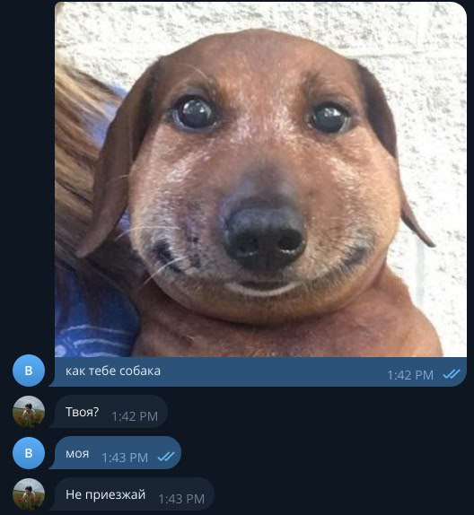

# Hey, I'm Dmitry 👋

I'm a **Machine Learning / Data Science** student at **HSE University, Saint Petersburg**  
**Applied Data Analysis & Artificial Intelligence**, School of Informatics, Physics and Technology, in partnership with **VK**.

I build applied ML systems end-to-end: from messy tabular data, validation and gradient boosting to PyTorch models, speech enhancement, RAG/OCR pipelines, and LLM-powered tools.

Currently open to **ML / DS internship opportunities**.

[](https://t.me/legenda0008)
[](mailto:dvsorochan@edu.hse.ru)
[](https://github.com/DmitryS-01)

---

## 🚀 Focus areas

- **Machine Learning / Data Science:** EDA, preprocessing, leakage checks, validation design, metrics, feature engineering, feature selection, class imbalance, gradient boosting, AutoML, ensembling
- **Deep Learning:** PyTorch, training loops, checkpoints, inference pipelines, CNN/RNN/LSTM, Transformers, attention mechanisms, audio/speech models
- **LLM / RAG systems:** document parsing, OCR, chunking, embeddings, vector search, retrieval, answer generation with citations, LaTeX generation
- **Applied AI tools:** AI assistants over private knowledge bases, handwritten notes processing, lecture notes generation, audio denoising apps
- **Engineering:** Python, SQL/PostgreSQL, Git, Docker, Linux CLI, Flask, Streamlit, Gradio, REST APIs, Telegram Bot API

---

## 🧠 Main projects

### 🎧 Speech Enhancement on VoiceBank+DEMAND

**Single-channel speech enhancement:**

```text
noisy wav → enhanced wav
```

Built a full deep learning pipeline for removing background noise from speech while preserving intelligibility.

**What I implemented:**

- STFT / ISTFT audio preprocessing and reconstruction
- TF-domain encoder-decoder architecture
- magnitude and phase denoising branches
- axial self-attention over time-frequency representations
- bidirectional magnitude/phase cross-attention
- training, validation checkpoint selection, full-test evaluation
- inference app for uploading noisy audio and downloading enhanced audio

**Evaluation:** VoiceBank+DEMAND benchmark, with PESQ as the main metric and STOI / CSIG / CBAK / COVL / SSNR as additional metrics.

**Best results:**

- **PESQ: 3.426** after adding MS-SNSD as an additional training dataset
- **STOI: 0.959**
- compact **CrossMP-Compact C88** model: ~**3.46M parameters**, **PESQ 3.3329** on VoiceBank+DEMAND
- earlier full experiment tracked **PESQ 3.3563**, **STOI 0.9592**, **SI-SDR 19.85**

**Stack:** Python, PyTorch, NumPy, audio preprocessing, STFT/ISTFT, Transformers/attention, Flask, Gradio, Hugging Face Spaces.

Repository: [SpeechDenoising-DL](https://github.com/DmitryS-01/SpeechDenoising-DL)  
Demo: [Hugging Face Space](https://huggingface.co/spaces/DmitryS-01/dlproject)

---

### 🧩 VK Predict CMC Hackathon — Top-1 private-score result

Tabular ML competition focused on predicting the probability of a user performing a hidden target action.

**Task:** binary classification / ranking  
**Metric:** ROC-AUC

**Data:**

- **247,972** training rows
- **106,274** test rows
- **1,367** anonymized features
- **1.35%** positive class rate
- high noise, masked values, strong class imbalance

Built an end-to-end competition pipeline:

- dataset audit and EDA
- train/test leakage checks
- missing values, noisy values and anomaly handling
- almost-constant and low-informative feature filtering
- feature-target analysis using correlation, single-feature AUC and LightGBM importance
- multicollinearity and duplicate-feature checks
- train/test distribution shift analysis
- feature engineering: cluster distances/labels, PCA/SVD components, polynomial interactions, frequency and rank transformations, binary activity flags, `log1p` transforms
- model training, tuning, refit and submission generation
- blending and ensemble weight search

**Models tested:**

- LightGBM, XGBoost, CatBoost, HistGradientBoosting
- Random Forest, ExtraTrees
- Logistic Regression
- FLAML AutoML
- TabM tabular deep learning baseline

**Best results:**

| Setup | ROC-AUC |
|---|---:|
| Best single model: LightGBM | **0.69428** |
| Blend: 2× LGBM + CatBoost | **0.70336** |
| Blend: 2× LGBM + CatBoost + FLAML + TabM | **0.71358** |
| Final power blend: 2× LGBM + CatBoost + FLAML + TabM + LogReg | **0.71513** |

Final blend exceeded the official top-1 leaderboard reference result of **0.71146**.

**Stack:** Python, Pandas, Polars, NumPy, scikit-learn, LightGBM, CatBoost, XGBoost, FLAML, Optuna, TabM, Jupyter.

Repository: [VK_CMC_hackathon](https://github.com/DmitryS-01/VK_CMC_hackathon)

---

### 📚 AI Study Assistant: RAG + handwritten notes to LaTeX lecture notes — in progress

An AI assistant for working with my university materials: PDF lectures, handwritten notes, course files, and personal study notes.

The system is designed to:

- search through a private knowledge base
- retrieve relevant fragments from lectures and notes
- answer questions with citations
- process handwritten materials
- generate structured **LaTeX lecture notes** using my own template

**Pipeline:**

```text
PDFs / handwritten notes / course files
→ document parsing + OCR
→ chunking
→ embeddings
→ vector search
→ retrieval
→ LLM answer generation with citations
→ LaTeX lecture notes generation
```

**Focus:** RAG, semantic search, embeddings, vector databases, OCR/document preprocessing, LLM-based question answering, LaTeX generation.

**Stack:** Python, LangChain, FAISS/Chroma, Streamlit, pypdf, OCR/preprocessing, LLM API, LaTeX.

Repository: **private for now, link soon**

---

### 🤖 DQN for generalized MNK game with D-properties

Reinforcement learning project for a generalized tic-tac-toe-like environment.

Implemented:

- game environment
- state and action space
- reward signal
- Deep Q-Network agent
- training loop
- strategy evaluation

**Focus:** reinforcement learning, Q-learning, neural value approximation, game environments.

Repository: [tic-tac-toe-RL-HSE-ADA-AI](https://github.com/DmitryS-01/tic-tac-toe-RL-HSE-ADA-AI)

---

### 📦 Ozon Tech “Robozon” — Computer Vision / Robotics Hackathon

Team project for a CV-based solution aimed at automating sorting-center workflows and intelligent item sorting.

My focus:

- data and annotation pipeline
- baseline approaches
- metrics
- experimental pipeline

Repository / write-up: **private for now, link soon**

---

## 🛠 Tech stack

**Languages:** Python, C++, C  

**ML / DS:** NumPy, Pandas, Polars, SciPy, scikit-learn, Statsmodels, Matplotlib, Plotly, Jupyter  

**Models / methods:** Linear/Logistic Regression, Ridge/Lasso, SVM/SVR, kNN, Decision Trees, Random Forest, ExtraTrees, LightGBM, CatBoost, XGBoost, HistGradientBoosting, PCA/SVD, clustering, anomaly detection, recommender systems basics, uplift/time series basics  

**Deep Learning:** PyTorch, CNN, RNN/LSTM, Transformers, attention mechanisms, audio/speech models, tabular DL basics, LLM/NLP basics  

**LLM / RAG:** RAG, embeddings, vector search, chunking, reranking basics, OCR/document parsing, answer generation with citations, LaTeX generation  

**Optimization / AutoML:** Optuna, FLAML, validation strategy, model selection, ensembling, stacking, blending, threshold tuning  

**Engineering:** SQL, PostgreSQL, Git, Linux CLI, Docker, Flask, Streamlit, Gradio, Hugging Face Spaces, REST API, Telegram Bot API, LaTeX

---

## 🎓 Education

**HSE University, Saint Petersburg**  
**Applied Data Analysis & Artificial Intelligence**, 2024–2028  
School of Informatics, Physics and Technology, in partnership with **VK**

Relevant coursework:

- Machine Learning
- Deep Learning
- Probability Theory
- Mathematical Statistics
- Numerical Methods
- Linear Algebra
- Optimization
- Algorithms and Data Structures
- Databases
- Python / C++ programming

---

## 🌱 A bit more about me

- English: **B2**
- Duolingo streak: **464 days**
- Interested in **chess**, ML systems, applied AI tools, speech processing, and building projects that are actually useful
- Also built Telegram bots for catalogs, orders, notifications, and API integrations

---

## 📫 Contacts

- Telegram: [@legenda0008](https://t.me/legenda0008)
- Email: [dvsorochan@edu.hse.ru](mailto:dvsorochan@edu.hse.ru)
- GitHub: [DmitryS-01](https://github.com/DmitryS-01)

---

## 🐟 meme 4 u


